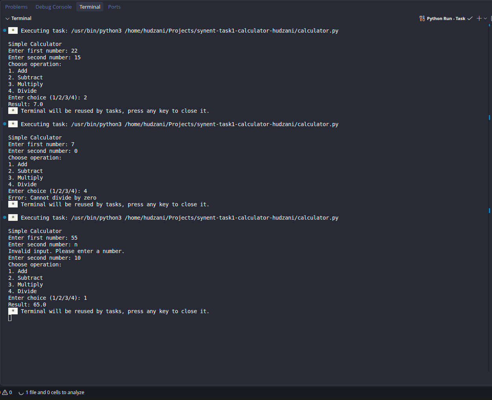

# Simple Calculator (CLI)

Synent Technologies Python Internship, Task 1.

A command line calculator that performs addition, subtraction, multiplication and division.

## Features

- Takes user input for two nnumbers 
- Handles invalid input (non-numeric values)
- Handles division by zero
- Displays results in the terminal


## How to run
```

python3 calculator.py
```

## Example output

```

   Enter first number: 10
    Enter second number: 45
    1.Add
    2.subtract
    3.Multiply
    4.Divide 
    Enter choice(1/2/3/4) : 1
     Result: 55.0  
```

## Methodology

1. Define a 'get_number()' function that keeps asking until the user enters a valid number('try/expect' catches letters).
2. Read two numbers and show a menu: add, subtract, multply, divide.
3. An 'if/elif/else' chain runs the chosen operation.
4. Division checks for zero first and prints an error instead of crashin.
5. Invalid menu choices print "Invalid choice".

## Screenshots



## Author 
Hudzani


